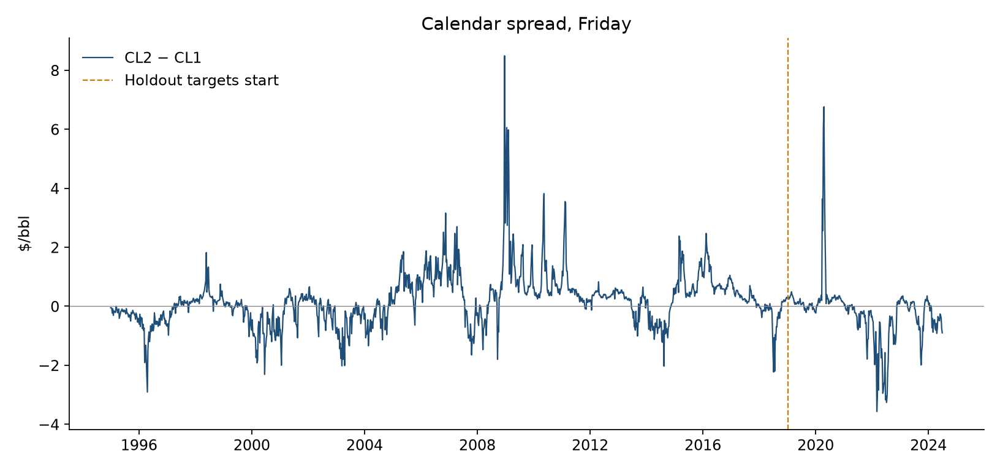
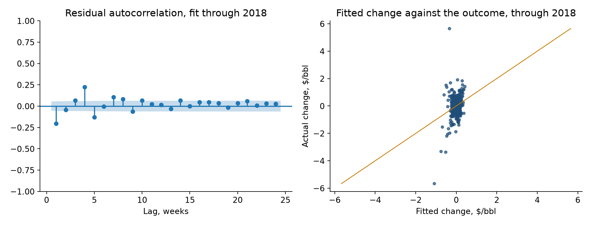
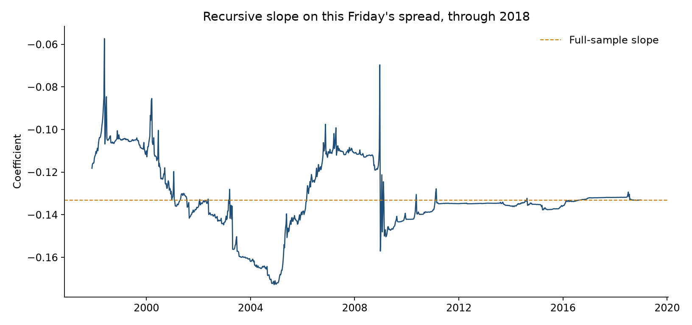
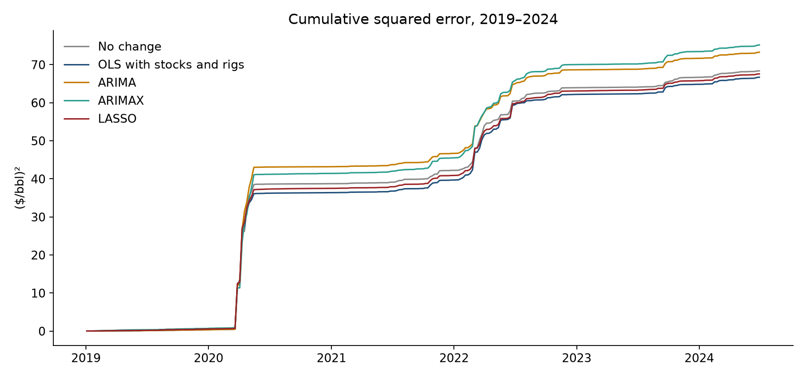
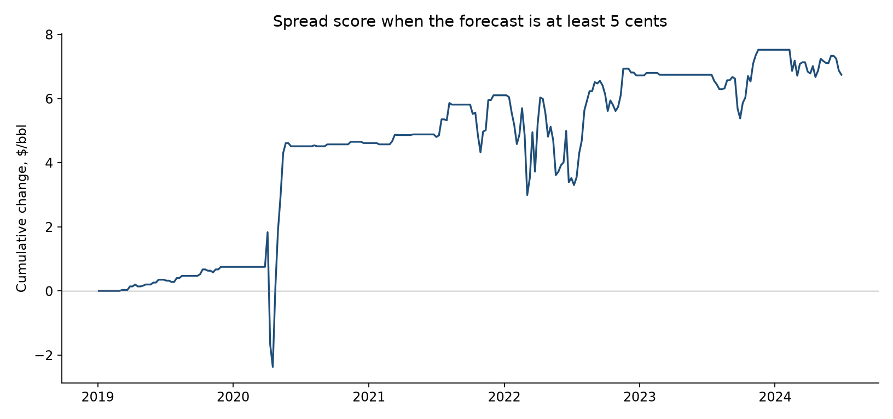

# Next week's move in the WTI calendar spread

## Abstract

The brief asks whether a simple model can help a trader form a view on oil futures. We forecast the week-ahead change in the calendar spread, CL2 minus CL1, in dollars per barrel. The frequency is weekly, because that is the horizon of the inventory report and of the industry sheet. Every number comes from `data/raw/Oil Data.xlsx`. The regression uses this Friday's spread, last week's crude-stock change and last week's change in the rig count. It is estimated through December 2018 and scored, one week at a time, from 4 January 2019 through 28 June 2024.

The slope on the spread is −0.13, about 13 cents of pullback per extra dollar of contango. A stock build goes with a slightly wider contango. The rig count does not register. On 287 holdout weeks the root-mean-square error is $0.48, against $0.49 for a forecast of no change. The spread alone is a fraction of a cent better. ARIMA, ARIMAX and ridge do worse than predicting no change, and a LASSO that includes the monthly yield curve does not beat the short regression. In the week ending 10 April 2020 the forecast was a 15 cent pullback and the spread rose $3.50.

## Introduction

A trader who books WTI futures has two decisions. Will the flat price rise, and is the front month cheap or expensive relative to the next month? The brief asks how a forecast can support that second decision, and it names the CL2–CL1 spread as a candidate. That is the series we forecast.

Let S = CL2 − CL1. When S is positive, the second month costs more than the front month: the curve is in contango. We forecast the change in S from one Friday to the next. That change, in dollars per barrel, is what a position long the second month and short the front month earns between those dates, before rolls, the bid–ask and margin.

The level of CL1 is a poor dependent variable. On Fridays through 2018, an augmented Dickey–Fuller test does not reject a unit root in CL1 or in CL2 (p = 0.26 and p = 0.33, with a trend), and a KPSS test rejects stationarity for both. The two prices drift. A regression of those levels on slow macro series would line up two trends and look meaningful for the wrong reason. On the same sample, the weekly change in the spread is stationary.

## Methodology

Weekly is the right frequency here. Daily and monthly each fail for a different reason.

A daily forecast matches how often the book is marked, and the daily sheet contains CL1 and CL2. Stocks and the rig count are weekly, and the macro sheet is monthly, so most days have no new predictor to attach. Of 9,226 daily rows, 534 have no date. On 20 April 2020 CL1 prints at −$37.63, and the spread moves from $6.76 on 17 April to $58.06, a one-day move of $51.30. That day sits inside a week. The forecast has to explain the Friday-to-Friday change, not that single print. Between inventory reports, a daily model would be forecasting noise.

A month can put prices, stocks and Treasury yields in one row, but the horizon is wrong. The curve trades the weekly stock print. A month bundles several of those prints into one observation and crosses the front contract's expiry, so the row mixes the curve with the roll. A stock effect visible on Fridays is averaged away by month-end.

A week matches the decision and the file. The industry sheet is every Friday from 30 December 1994 through 28 June 2024, 1,540 Fridays with no gaps. It has stocks, rigs, production and positions. CL1 and CL2 come from the daily sheet: Friday's own print on 1,474 of these Fridays, and the previous session on the other 66, never more than two days earlier. Monthly yields stay out of the reported regression, so that one month-end number is not copied onto every Friday of the month. They enter the ridge and LASSO comparisons only, as the latest month-end on or before the Friday. Industrial production and gasoline describe a month and are published later, so those comparisons use the previous month's change.

The stock column is already a weekly change. The rig count is a level, so we use its weekly difference. Both are lagged one week. The sheet dates the week a number describes, and the stock release comes out after that Friday. The lag is what makes the stock change known at the close we forecast from.

We chose these inputs from the storage and supply story, before any coefficient was estimated. A barrel can be sold now or stored and sold later. The spread is the payment for waiting: the tank, and the interest tied up in the oil. When contango is already wide, storage pays, barrels move into tanks and the gap should narrow, which is why today's spread is an input. Stocks are the oil already in the tanks. A build leaves the front month less scarce, so CL1 should ease relative to CL2 and the spread should rise. The rig count is supply not yet in the tanks. The definitions sheet calls it a leading indicator of production: more rigs mean more barrels later, and that should loosen the front of the curve. Brent is a different crude, and equity prices are companies rather than the barrel balance, so both are left out. Interest rates are part of the cost of holding oil, but they are monthly, so they are used only in the comparisons.

Estimation stops at the target week of 28 December 2018, so the move into 4 January 2019 is not used in the fit that forecasts it. The unit-root tests, the information criterion and the diagnostics use the same cut-off.

The reported model is ordinary least squares:

change in S next week = a + b × S + c × stock change + d × rig change + error.

S is this Friday's spread. On the holdout the regression is re-estimated every week, on earlier Fridays only. The estimation sample is the 1,250 target weeks from 20 January 1995 through 28 December 2018. The holdout is the 287 target weeks from 4 January 2019 through 28 June 2024. Ridge and LASSO omit seven Fridays in January and February 1995, because the monthly series are not yet available. The reported regression keeps those weeks. No coefficient, ARIMA order or penalty is chosen on the holdout.

The comparisons, scored on the same weeks, are a forecast of no change, the same regression using only the spread, an ARIMA whose order is chosen by AIC on the pre-2019 spread, an ARIMAX with the lagged stock and rig changes, and ridge and LASSO on a wider set. That set adds production, commercial positions and the crack, plus the latest monthly yield curve, VIX, industrial production, the dollar and gasoline. The ridge penalty is fixed at 10. LASSO chooses its penalty inside each training window. The regression and the tests follow Brooks, *Introductory Econometrics for Finance*. Ridge and LASSO follow James, Witten, Hastie and Tibshirani, *An Introduction to Statistical Learning*, chapter 6.

## Results

The table is one fit, through 28 December 2018, with Newey–West standard errors and seven lags.

| Term | Estimate | Standard error | t | p-value |
| --- | ---: | ---: | ---: | ---: |
| Intercept | 0.027 | 0.012 | 2.17 | 0.030 |
| Spread, CL2 − CL1 | −0.133 | 0.024 | −5.55 | < 0.001 |
| Stock change, lagged | 0.0000078 | 0.0000031 | 2.49 | 0.013 |
| Rig-count change, lagged | −0.0008 | 0.0009 | −0.88 | 0.38 |

The R² is 0.069 and the adjusted R² is 0.066, so little of next week's move is explained. A curve $1 further into contango is associated with about 13 cents of pullback next week. The intercept is about 3 cents. If stocks and rigs are unchanged, a $1 spread is fitted to fall by about 11 cents, and next week's spread equals about 0.87 times this week's spread plus that intercept. The equation settles near 20 cents of contango, and a gap from that level closes halfway in about five weeks.

The stock coefficient is positive: a build goes with a higher spread the next week. A one-standard-deviation move in that column on the estimation sample, about 4,030, lines up with about 3.1 cents. The rig-count coefficient cannot be distinguished from zero.

The residuals are serially correlated, which is why the standard errors are Newey–West. Durbin–Watson is 2.41. Ljung–Box rejects uncorrelated residuals at one, four and twelve weeks, and Breusch–Godfrey rejects at four weeks. Seven lags is the usual rule of thumb for a sample of 1,250 weeks.

The ARIMA is fitted to the spread itself, in levels. Through 2018 the Dickey–Fuller statistic on the spread is −5.38, against a 5% critical value of −2.86, so a unit root is rejected. KPSS rejects as well: the spread is persistent. AIC, searching orders up to 2, selects ARIMA(1, 0, 2). With the stock and rig terms included, it selects ARIMAX(1, 0, 1). Breusch–Pagan rejects constant variance, so the regression is a forecast of the average move only.

The size of the slope is not constant. A Chow test at the target week of 12 January 2007, the middle of the estimation sample, has p = 0.002. A CUSUM test has p < 0.001. The sign stays negative in every window, and after about 2011 the slope sits near −0.13.

Each forecast from 2019 to 2024 uses only earlier Fridays.

| Model | RMSE ($) | MAE ($) | R² against no change | Direction |
| --- | ---: | ---: | ---: | ---: |
| No change | 0.488 | 0.234 |  |  |
| OLS: spread, stocks, rigs | 0.482 | 0.232 | 2.4% | 49.5% |
| OLS: spread only | 0.479 | 0.228 | 3.8% | 54.0% |
| ARIMA(1, 0, 2) | 0.505 | 0.238 | −7.2% | 54.0% |
| ARIMAX(1, 0, 1): stocks and rigs | 0.512 | 0.261 | −10.0% | 53.0% |
| LASSO, wider set, including yields | 0.485 | 0.238 | 1.1% | 48.1% |
| Ridge, wider set, including yields | 0.496 | 0.254 | −3.1% | 48.4% |

The root-mean-square error of a no-change forecast is about 49 cents. The reported regression brings that to about 48 cents, and the spread alone is slightly better. ARIMA and ARIMAX are both worse than a forecast of no change. LASSO keeps a small weight on the yield curve and drops the rig count. It beats no change, and it loses to the short regression. Ridge loses to no change.

The three-variable forecast gets the direction right in 49.5% of holdout weeks. The stock term visible through 2018 does not pay for itself on 2019–2024. The largest holdout move is the week ending 10 April 2020. The spread was +$2.56 and the forecast was −$0.15. The spread then rose by $3.50. The regression describes a drift back toward a small contango. It does not describe the week the curve blows out.

The trading rule was set before the holdout was scored. If the three-variable forecast is at least 5 cents, take its sign. A positive forecast means CL2 − CL1 is expected to rise, so the position is long the second month and short the front month. Below 5 cents, do nothing. The rule trades 135 of the 287 weeks. The direction is right in 56% of the weeks traded. The cumulative change on the position is +$6.74 per barrel, flat weeks included.

That sum is dollars per barrel of the Friday spread, before the roll and the bid–ask. Five cents is a threshold we chose, not a cost measured in the market. The stock and rig terms stay because they were the specification. On this holdout, the spread alone had the smaller error.

## Conclusion

The regression uses this Friday's spread, the lagged stock change and the lagged change in the rig count. The spread does almost all of the work. Stocks enter with the expected sign, a build going with a wider contango, but the effect is only a few cents and it does not improve 2019–2024. The rig count does not enter. The monthly yields, tested in LASSO and ridge, do not help. Out of sample, the short forecast beats a prediction of no change by about half a cent of root-mean-square error. The residuals are autocorrelated, and the size of the slope is not constant, though its sign stays negative. A desk can use the number to lean against a curve that is already far from flat, and should size any position for a move of several dollars that this regression will not see coming.

Program: `coursework/analysis.py` and `coursework/analysis.ipynb`. Figures: `data/results/coursework/`. Slides: `coursework/briefing.pptx`. This note is a draft for the group to rewrite. The authors are accountable for the text they hand in.
